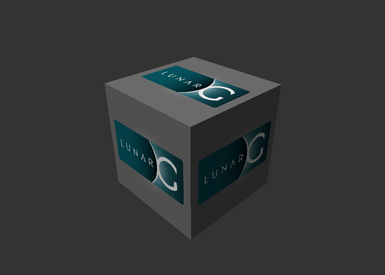

# Broadwell Vulkan: HasVK/WDDM для Intel Iris 6100

Экспериментальный Vulkan-драйвер (ICD) для Windows x64 на основе Mesa HasVK
26.2.7. Он работает поверх штатного WDDM-драйвера ядра Intel
`20.19.15.5171` на Intel Iris 6100 (`8086:162b`); Intel UMD и D3D12 в процесс
не загружаются. Другие GPU и версии драйвера не поддерживаются: на них ICD не
показывает ни одного устройства.

## Состояние

- Vulkan 1.3, 107 расширений устройства. Собственный транспорт WDDM, штатные
  SPIR-V → NIR → ELK → Gen8, ISL, BLORP и runtime Mesa.
- Вывод в окно без копии через CPU, режимы FIFO, MAILBOX, IMMEDIATE.
- CTS 1.4.5.5 проверен выборками по группам; полный прогон не выполнялся,
  драйвер не сертифицирован. Известные отказы —
  [docs/cts-expected-failures.md](docs/cts-expected-failures.md).
- Проверенные приложения: `vulkaninfo`, `vkcube`, `vkcubepp`, The Talos
  Principle.
- Текущая работа — производительность. Цель: Vulkan быстрее DX11 в The Talos
  Principle. Сейчас 70–83 FPS (чаще 75–79) против 79–87 у DX11 на драйвере
  Intel в тех же сериях прогонов (в начале работы — 27,8 FPS). На одинаковой
  работе драйвер вровень с драйвером Intel; остаток разрыва задаёт путь Vulkan
  самой игры (тени заново каждый кадр забирают общий бюджет питания CPU и GPU) —
  разбор в [docs/optimizations-vs-dx11.md](docs/optimizations-vs-dx11.md).



## Документация

- [docs/roadmap.md](docs/roadmap.md) — что сделано и что осталось.
- [docs/optimizations-vs-dx11.md](docs/optimizations-vs-dx11.md) —
  производительность: итог, измерения, что изменено, статус гипотез,
  отклонённые опыты, команды для повторения каждого замера, методика.
- [docs/install.md](docs/install.md) — установка, кэш шейдеров, переменные
  окружения, ограничения (эта инструкция входит в релизный пакет).
- [docs/cts-expected-failures.md](docs/cts-expected-failures.md) — известные
  отказы CTS.
- [docs/intel-interface.md](docs/intel-interface.md) — закрытый интерфейс
  Intel, от которого зависит порт, и порядок переноса на другую версию
  драйвера.
- [gpu-probe/README.md](gpu-probe/README.md) — исходный C#-прототип прямого
  доступа к GPU.

## Сборка

Нужны минимум 25 ГиБ свободного места перед установкой зависимостей.
Все команды выполняются из корня проекта в PowerShell x64:

```powershell
powershell.exe -NoProfile -ExecutionPolicy Bypass -File .\tools\bootstrap.ps1
powershell.exe -NoProfile -ExecutionPolicy Bypass -File .\tools\test-all.ps1
```

Bootstrap устанавливает MSVC/SDK и Python, получает Mesa 26.2.7 и зависимости
с закреплёнными SHA-256. Для GNU-расширений ELK используется clang-cl 19.1.5.
Из официального Microsoft VSIX извлекаются только необходимые файлы x64:
оглавление проверяется SHA-256, файлы — ZIP CRC, их SHA-256 сохраняются в манифест.
Полный архив VSIX при этом не загружается и не считается проверенным целиком.
Версии Python-пакетов закреплены в `tools/requirements.txt`.
MSVC 14.44.35207, SDK 10.0.26100.0 и хеши компиляторов/заголовков KMT закреплены
в `tools/toolchain-lock.json`; сборка останавливается при несовпадении.
Онлайн-установщик Visual Studio может менять состав пакетов: для повторной
установки именно этой версии следует сохранить локальные инструменты/пакеты.
`ExecutionPolicy Bypass` действует только для запускаемого процесса.

Установленные инструменты находятся в `.tools`, исходники зависимостей —
в `third_party`, сборки и подробные журналы — в `build`. Windows SDK и служебный
установщик Visual Studio используют стандартные системные каталоги.

Изменения Mesa воспроизводятся скриптом `mesa/apply-compiler-port.py` и
сохраняются в `mesa/patches/compiler-port.patch`. ICD собирает
`tools/build-icd.ps1`; готовый комплект (DLL и JSON-манифест) лежит в
`build/icd`.

## Проверки

Все проверки идут на настоящей GPU и не требуют участия пользователя.

- `tools/test-all.ps1` — общий прогон аппаратных проб с побайтной или
  попиксельной сверкой результатов; ключ `-SkipBuild` запускает его на уже
  собранных файлах.
- Отдельные пробы: `test-native.ps1` (транспорт WDDM), `test-elk.ps1`,
  `test-spirv.ps1`, `test-images.ps1`, `test-icd.ps1`, `test-graphics.ps1`,
  `test-wsi.ps1` (вывод в окно), `test-oom.ps1`, `test-leaks.ps1`,
  `test-device-lost.ps1`, `test-kernel-limits.ps1`,
  `test-present-redirect.ps1`, `test-validation.ps1` (validation layers),
  `test-stability.ps1`.
- CTS: `build-cts.ps1`, `run-cts.ps1` и срезы по группам
  (`run-cts-sample.ps1`, `run-cts-groups.ps1`, `run-cts-vk13.ps1`,
  `run-cts-extensions.ps1`).
- `run-talos.ps1` — встроенный бенчмарк The Talos Principle под Vulkan и DX11
  (`-Sample` — потоки, частота CPU и загрузка GPU в окне замера;
  `-RipModule` — сэмплы стеков; `-D3D11Proxy` — разбивка кадра DX11).
- Диагностика производительности: `build-probes.ps1` (пробы, `rip_sampler`,
  прокси `d3d11.dll`), журнал кадра `HASVK_WDDM_TIMELINE` с разбором
  `timeline-report.py`, таблицы кадров игры — `bench-frames.py`, секции
  кадра игры в миллисекундах по API — `talos-sections.py`, сравнение
  выборок кода двух прогонов — `rip-compare.py`.

Что именно проверяет каждая проба и с каким результатом — в
[docs/roadmap.md](docs/roadmap.md), раздел 1. Компактные отчёты прогонов —
в `native/artifacts`.

## Использование

Для одного приложения, без установки:

```powershell
$env:VK_DRIVER_FILES = "<корень проекта>\build\icd\intel_hasvk_wddm_icd.json"
& "<приложение>.exe"
```

Системная установка и удаление — `tools/install-icd.ps1`, инструкция в
[docs/install.md](docs/install.md). Релизный пакет собирает
`tools/make-release.ps1`.

## Состав репозитория

В Git сохраняются исходники, патч к закреплённой Mesa, скрипты и компактные
отчёты. `.tools`, `third_party`, `build` и захваты `gpu-probe/artifacts` остаются
локальными. Bootstrap получает внешние зависимости заново. Сохранённые Intel
ISA/описатели контрольного C# и раннего raw-теста в репозиторий не входят:
для `test-all.ps1` нужны локальные контрольные fixtures. Самостоятельные Vulkan
compute/graphics тесты (`test-icd.ps1`, `test-graphics.ps1`) их не используют.
